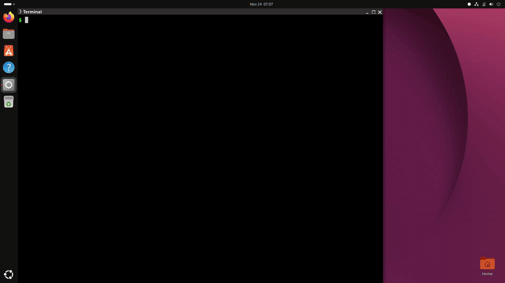

# GNOME Window Control

[](https://github.com/carlo9890/gnome-window-control/actions/workflows/build.yml)
[](https://github.com/carlo9890/gnome-window-control/releases/latest)
[](LICENSE)

List, move and tile windows on GNOME Shell from a script, a rules file, or the
keyboard. It works on Wayland, where `wmctrl` and `xdotool` reach only
XWayland windows.


**What happens in the recording:**

1. `wctl list` shows every window with its ID, title and WM class.
2. `wctl tile -c logs top-right` and `wctl tile -c chat bottom-right` tile two
   windows by their class.
3. `wctl tile focused wide-left` tiles the terminal itself into the space that
   is left.

One GNOME Shell extension, three ways to use it:

- **From a script**: `wctl`, a single static binary, or any D-Bus client such
  as `gdbus`.
- **On window creation**: rules in `rules.json` place a matching window the
  moment it opens.
- **From the keyboard**: `Super+Ctrl` plus a numpad key tiles the focused
  window, and the numpad `*` applies the rules again.

A preferences window rebinds the shortcuts and edits `rules.json` with a
check as you type, and an optional top-bar icon applies the rules again.

## Get started

Install the extension from its
[page on extensions.gnome.org](https://extensions.gnome.org/extension/10886/window-control/).
[Install](docs/user-guide/install.md) has both paths.

> [!WARNING]
> On 2026-11-24, extensions.gnome.org still served version 9, which has no
> rules, no keyboard shortcuts, and no support for `wctl`. Until it serves the
> current release, install the zip from the
> [GitHub release](https://github.com/carlo9890/gnome-window-control/releases/latest)
> as [Install](docs/user-guide/install.md#from-github-releases) says.

Install `wctl` into `~/.local/bin`:

```bash
curl -fsSL https://github.com/carlo9890/gnome-window-control/releases/latest/download/install-wctl.sh | bash
```

Then move a window:

```bash
wctl list                                  # every window, with ID, class and title
wctl tile -c kitty left                    # tile the kitty window to the left column
wctl place focused right top 50% 100%      # right half of the workarea
wctl minimize focused                      # minimize the focused window
```

[Getting started](docs/user-guide/getting-started.md) takes you from here to a
first rule and a first shortcut.

## Tile from the keyboard


The numpad mirrors a 4x2 grid. `Super+Ctrl` plus the numpad `7` tiles the
focused window top-left, the numpad `3` bottom-right, and the numpad `+`
makes it three columns wide. [Keyboard shortcuts](docs/user-guide/shortcuts.md) has the full
table and how to rebind a key.

## Open every window in its place



A rule names the windows it matches and where they go. The extension places a
matching window the moment it opens, and `Super+Ctrl` plus the numpad `*` puts
every window a rule matches back in its place. A rule can also make a window an overlay, like a drop-down
terminal. [Automatic window placement](docs/user-guide/rules.md) has the
format.

## What you can do

- **Script any window**: list, focus, move, resize, tile, minimize, maximize,
  fullscreen, keep on top, move to a workspace or a monitor, and wait for a
  window to open. [Using wctl](docs/user-guide/wctl.md)
- **Address a window by name**: by ID, `focused`, WM class, title, part of the
  title, or PID. [Concepts](docs/user-guide/concepts.md)
- **Keep rules per tool**: other programs add their rules as drop-in files,
  without touching yours. [Drop-in files](docs/user-guide/rules.md#drop-in-files-rulesd)
- **Find why a rule did not fire**: `wctl rules test` names the rule that wins
  and the rectangle it gives. [Why did a rule not fire?](docs/user-guide/rules.md#why-did-a-rule-not-fire)
- **Call it from any language**: the extension is a D-Bus interface.
  [D-Bus interface](docs/user-guide/dbus.md)

## Security

Any application in your session can call this interface: it can read your
window titles and move, resize or close your windows. Read the
[Security model](docs/user-guide/security.md) before you enable the extension.

## Documentation

- **Users**: [docs/user-guide/](docs/user-guide/), every user page, by task.
- **Contributors**: [CONTRIBUTING.md](CONTRIBUTING.md), building from source,
  testing, and the doc that owns each topic.
- **AI coding agents**: [AGENTS.md](AGENTS.md) is the routing entrypoint.

## License

MIT License - see [LICENSE](LICENSE) file.
