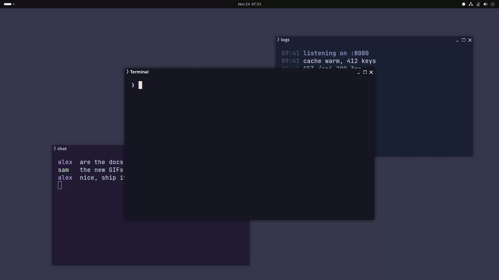
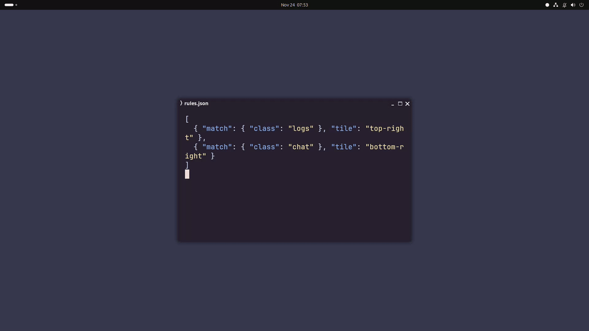

# GNOME Window Control

[](https://github.com/carlo9890/gnome-window-control/actions/workflows/build.yml)
[](https://github.com/carlo9890/gnome-window-control/releases/latest)
[](LICENSE)

List, move and tile windows on GNOME Shell from a script, a rules file, or the
keyboard. It works on Wayland, where `wmctrl` and `xdotool` reach only
XWayland windows.



One GNOME Shell extension, three ways to use it:

- **From a script**: `wctl`, a single static binary, or any D-Bus client such
  as `gdbus`.
- **When a window opens**: a rule in `rules.json` places a matching window.
- **From the keyboard**: `Super+Ctrl` plus a numpad key tiles the focused
  window.

## Install

Install the extension zip from
[GitHub Releases](https://github.com/carlo9890/gnome-window-control/releases/latest),
or from [extensions.gnome.org](https://extensions.gnome.org/extension/10886/window-control/).
extensions.gnome.org can lag behind; install from GitHub Releases when its
version lacks a feature you need. Then install `wctl`.
[Install](docs/user-guide/install.md) has the steps.

## First use

```bash
wctl list                                  # every window, with ID, class and title
wctl tile -c kitty left                    # tile the kitty window to the left column
wctl place focused right top 50% 100%      # right half of the workarea
wctl rules add -c kitty tile left          # open every kitty window there
```

[Getting started](docs/user-guide/getting-started.md) takes you to a first
rule and a first shortcut.

## Tile from the keyboard



The numpad mirrors a 4x2 grid. See
[Keyboard shortcuts](docs/user-guide/shortcuts.md).

## Open every window in its place


A rule names the windows it matches and where they go. A rule can also make a
window an overlay, like a drop-down terminal. See
[Automatic window placement](docs/user-guide/rules.md).

## Security

Any application in your session can call the extension: it can read your
window titles and move, resize or close your windows. Read the
[Security model](docs/user-guide/security.md) before you enable it.

## User guide

The [user guide](docs/user-guide/README.md) covers the rest: install, the
concepts, `wctl`, the rules file, the shortcuts and preferences, the D-Bus
interface, security, and troubleshooting.

## Contributing

To build from source or propose a change, see [CONTRIBUTING.md](CONTRIBUTING.md).

## License

[MIT](LICENSE).
