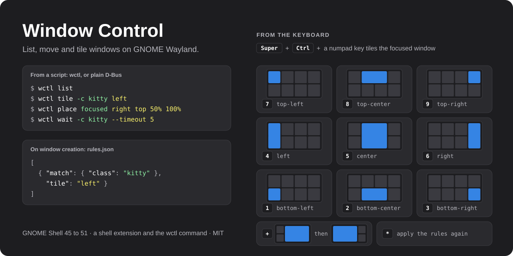

# User guide

This guide tells you how to install and use GNOME Window Control: the
extension, the `wctl` CLI, the rules file and the keyboard shortcuts.

## Find it by task

| I want to... | Read |
|--------------|------|
| Try the extension for the first time | [Getting started](getting-started.md) |
| Install the extension and `wctl` | [Install](install.md) |
| Move from the old `window-control@hko9890` extension | [Install: Upgrading from window-control@hko9890](install.md#upgrading-from-window-controlhko9890) |
| Know which GNOME Shell versions it supports | [Install: Compatibility](install.md#compatibility) |
| Know what a selector, the workarea, the tile grid or a capability is | [Concepts](concepts.md) |
| List, move, tile or wait for windows from a script | [Using wctl](wctl.md) |
| Know what a `wctl` exit code means | [Using wctl: Exit codes](wctl.md#exit-codes) |
| Place a window when it opens | [Automatic window placement](rules.md) |
| Find out why a rule did not fire | [Automatic window placement: Why did a rule not fire?](rules.md#why-did-a-rule-not-fire) |
| Tile the focused window from the keyboard | [Keyboard shortcuts and preferences: Keyboard shortcuts](shortcuts.md#keyboard-shortcuts) |
| Rebind a shortcut, edit the rules in a window, or show the top-bar icon | [Keyboard shortcuts and preferences: Preferences window and top-bar icon](shortcuts.md#preferences-window-and-top-bar-icon) |
| Call the extension from `gdbus` or another D-Bus client | [D-Bus interface](dbus.md) |
| Know who can call the extension | [Security model](security.md) |
| Fix a problem | [Troubleshooting](troubleshooting.md) |
