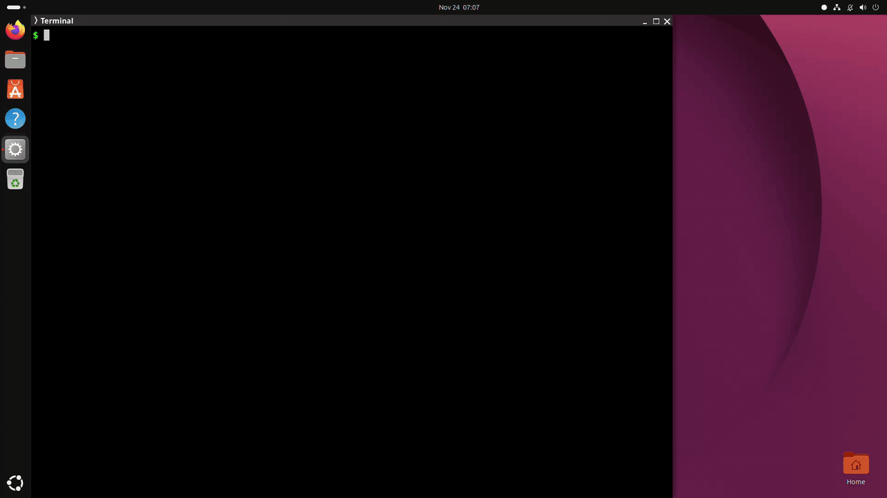
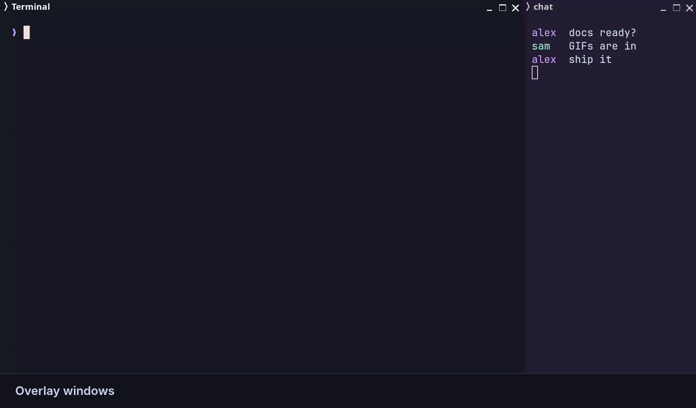

# Automatic window placement



The extension places a window when it opens. The rules are in
`~/.config/gnome-window-control/rules.json`, a JSON array. The extension reads
the file again when it changes; no restart is necessary. Edit the file with a
text editor, with [`wctl rules`](#managing-rules-from-the-command-line), or on
the Rules page of the
[preferences window](shortcuts.md#preferences-window-and-top-bar-icon).

```json
[
  { "match": { "class": "kitty" },        "tile": "left" },
  { "match": { "substr": "Report" },      "place": ["right", "top", "50%", "100%"] },
  { "match": { "title": "Calculator" },   "center": "both", "monitor": 1 },
  { "match": { "class": "Slack" },        "workspace": 2 }
]
```

| Key | What it does | Value |
|-----|--------------|-------|
| `match` | The windows the rule applies to. All its keys must match. | An object of the keys below |
| `match.class` | The WM class is equal. | A string |
| `match.title` | The title is equal. | A string |
| `match.substr` | The title contains it. | A string |
| `match.title_prefix` | The title starts with it. | A string |
| `match.title_suffix` | The title ends with it. | A string |
| `match.class_prefix` | The WM class starts with it, for a class with a part per window, such as a Chrome app window. | A string |
| `match.min_width` | The monitor is at least this wide; see [Rules per monitor size](#rules-per-monitor-size). | Logical pixels |
| `place` | Puts the window at a position and size; see [The workarea](concepts.md#the-workarea). | `[X, Y, WIDTH, HEIGHT]` |
| `tile` | Puts the window on the tile grid. | A [tile position](concepts.md#the-tile-grid) |
| `center` | Centers the window and keeps its size. | `horizontal`, `vertical` or `both` |
| `workspace` | Moves the window to the workspace. An index after the last workspace adds one workspace and moves the window there, not to that index; `wctl rules apply` skips such an index. | A workspace index |
| `monitor` | Puts the window on the monitor. When the monitor does not exist, only `workspace` and `overlay` apply. | A monitor index |
| `overlay` | Makes the window an [overlay](#overlay-windows). | `true` |

A rule has at most one of `place`, `tile` and `center`. The first rule that
matches wins, and it applies once to each new window.

On GNOME 49 and later, a `place` or `tile` rule puts the window in position
before it is drawn. On GNOME 45 to 48, for `center` and `workspace`, for an app
that runs through Xwayland, and for a window that gets its class or title late,
the window opens and then moves.

A rule sets the initial position only. When an app resizes itself later, run
[`wctl rules apply`](#resetting-windows-to-their-rules).

A file with a bad value is not used until you fix it. The other files still
load; see [Checking the file](#checking-the-file).

## Drop-in files (rules.d)

A tool that adds its own rules writes them to one file in
`~/.config/gnome-window-control/rules.d/`, for example `rules.d/revier.json`.
It does not edit `rules.json`. A drop-in file has the format of `rules.json`.

- The extension reads `rules.json` first, then each drop-in file in name
  order. Thus a rule in `rules.json` wins over a drop-in rule: override the
  rule of a tool there.
- The extension reads a name of letters, digits, `.`, `_` and `-` that starts
  with a letter or a digit and ends in `.json`. It skips all other files and
  subfolders. To disable a file, rename it to `<name>.json.off`.
- A tool writes a temporary file whose name starts with `.`, then renames it
  into place. Before it writes, it runs `wctl rules check --file <PATH>` and
  checks that `wctl version --json` lists `rules-dropin`.

```bash
wctl rules path --dir                                  # the rules.d folder
wctl rules add --file ~/.config/gnome-window-control/rules.d/mytool.json -c mytool tile right
```

## Rules per monitor size

`min_width` in `match` makes a rule match only on a monitor that is at least
that many logical pixels wide. Put the rule before a rule without it; the
second rule then applies on a smaller monitor:

```json
[
  { "match": { "class": "kitty", "min_width": 3000 }, "place": ["center", "top", "75%", "100%"] },
  { "match": { "class": "kitty" },                    "place": ["center", "top", "100%", "100%"] }
]
```

- The monitor is the `monitor` of the rule, or else the monitor the window
  opens on.
- The logical width is the width after scaling: a 3840 px monitor at 200% is
  1920 wide. `wctl monitors` shows the logical width with GNOME 50 or later,
  or with fractional scaling on, and the physical width otherwise.
- When the rule's `monitor` does not exist, a rule with `min_width` does not
  match, and the next rule can.

## Overlay windows



A rule with `"overlay": true` makes its windows act like a drop-down terminal:

- The window stays above the other windows.
- Alt+Tab and the overview do not show it. The dash still shows its app.
- The window minimizes when another window keeps the focus for a quarter of a
  second, or when the overview opens. A dialog of the overlay or a shell menu
  does not hide it. A click on the empty desktop hides it only when a
  desktop-icons extension draws the desktop.

Show the window again with a keyboard shortcut:

```bash
wctl rules add -c quake place center top 100% 40% --overlay
# Bind this command to a key in Settings > Keyboard > Custom Shortcuts:
sh -c 'wctl unminimize -c quake --no-animation; case $? in 0) wctl activate -c quake ;; 2) exec kitty --class quake ;; esac'
```

Give the overlay app a class of its own: each window that the rule matches
becomes an overlay. The overlay part of a rule also applies to the windows that
are open when the file loads. Match an overlay by class, not by title: a load
tests a title rule against the title the window has at that time.

`wctl info` lists `overlay` in the states of a window.

## Managing rules from the command line

```bash
wctl rules add -c kitty tile left               # Tile every kitty window left
wctl rules add -s Report place right top 50% 100%
wctl rules add -t Calculator center both --monitor 1 --workspace 2
wctl rules add -c Slack --workspace 2            # Only move it to a workspace
wctl rules add -c quake --overlay                # Make it an overlay window
wctl rules list                                  # Every rule, rules.json and rules.d
wctl rules remove 0                              # Remove a rule by index
wctl rules path                                  # Where the file is
```

```console
$ wctl rules list
SOURCE               INDEX  MATCH             ACTION                     WORKSPACE  MONITOR  OVERLAY
rules.json           0      class=kitty       tile left
rules.json           1      substr=Report     place right top 50% 100%
rules.json           2      title=Calculator  center both                2          1
rules.d/revier.json  0      class=quake       place center top 100% 40%                      yes
```

`INDEX` counts in each file. `remove` and `add --at` use it; add `--file` for
a drop-in file. `add` and `remove` do not change a file that is not valid.

When `rules.json` is a symbolic link, `add` and `remove` write the linked file.
The extension does not see an edit you make to the linked file. After such an
edit, run `touch -h ~/.config/gnome-window-control/rules.json`.

### Keys that need a newer extension

An extension that does not report the capability of a key refuses a file that
has the key. Without `rules-dropin` it ignores the `rules.d` folder, and without
`rules-apply` `wctl rules apply` exits 5. `wctl version --json` lists the
capabilities.

| Key | Capability |
|-----|------------|
| any rule | `rules` |
| `title_prefix`, `title_suffix` | `rules-title-affix` |
| `class_prefix` | `rules-class-prefix` |
| `overlay` | `rules-overlay` |
| `min_width` | `rules-min-width` |
| a file in `rules.d` | `rules-dropin` |
| `wctl rules apply` | `rules-apply` |

## Checking the file

Check the file before you save it in place:

```bash
wctl rules check                      # rules.json and each drop-in file
wctl rules check --file ./draft.json  # any file
```

```console
$ wctl rules check
/home/you/.config/gnome-window-control/rules.json: 3 rules, valid

$ wctl rules check
Error: rules[1].tile: must be one of top-left, top-center, top-right, left, center, right, bottom-left, bottom-center, bottom-right, wide-left, wide-right
```

It exits 0 when the extension would load every file, and 1 when it would not.
The message is the one the extension writes to the journal. It reads only the
files, so the extension need not run.

## Why did a rule not fire?

```bash
wctl rules test -c kitty
```

```console
$ wctl rules test -c kitty
Window 4152763  class=kitty  title=vim
Matched rule 0: class=kitty -> tile left
  rule 2 also matches but is shadowed: class=kitty -> tile right
  monitor 0, workarea 0,27 1920x1053
  would place at 0,27 480x1052
```

It shows the rule that wins, the later rules that also match and thus never
apply, the workarea, and the rectangle. For a `center` rule that first
restores a maximized window or moves it to another monitor, it says so instead
of a rectangle. It moves nothing. The extension must
run.

`wctl rules test` and `wctl rules apply` exit 5 when the extension lacks the
capability they need; see
[Keys that need a newer extension](#keys-that-need-a-newer-extension).

They leave out any other file that the extension does not use, with a warning.

## Resetting windows to their rules

```bash
wctl rules apply             # every open window
wctl rules apply -c kitty    # one window
```

The extension applies its rules again, as to a new window. `min_width` tests
the monitor the window is on now. Use it after you move windows by hand, or
after you dock or undock a laptop. The numpad `*`
[shortcut](shortcuts.md#keyboard-shortcuts) does the same, without the file
check and the count.

A window that no rule matches does not move.

It prints how many windows a rule matched. It first checks the files, as
`wctl rules check` does, and reads a change you saved just before.
