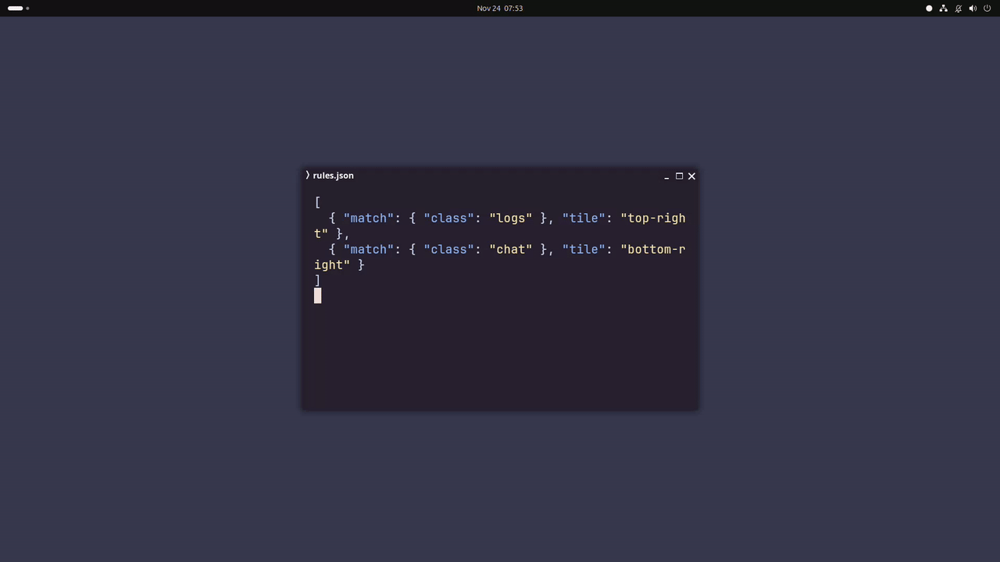

# Keyboard shortcuts and preferences

## Keyboard shortcuts



`Super+Ctrl` plus a numpad key tiles the focused window to a position of
[the tile grid](concepts.md#the-tile-grid). The numpad mirrors the grid, with
Num Lock on or off:

| Key | Position | | Key | Position | | Key | Position |
|---|---|---|---|---|---|---|---|
| `7` | `top-left` | | `8` | `top-center` | | `9` | `top-right` |
| `4` | `left` | | `5` | `center` | | `6` | `right` |
| `1` | `bottom-left` | | `2` | `bottom-center` | | `3` | `bottom-right` |

- The numpad `+` tiles the window `wide-right`. Press it again and it goes
  `wide-left`.
- The numpad `*` applies the rules again to every open window, as
  `wctl rules apply` does. It reports nothing; run `wctl rules check` to see
  an error.
- A fullscreen window is left alone. A maximized window is restored first,
  then placed.

### Use a key of the main keyboard

The defaults need a numpad. To use the `*` of the main keyboard, record it on
the Shortcuts page of the [preferences window](#preferences-window-and-top-bar-icon):
Super+Shift+8 on a US layout, Super+Shift+`+` on a German one. Do not write
`<Super>asterisk` by hand: it then fires on Super+8 (US) or Super+`+`
(German), and on US it takes Super+8 from GNOME's "switch to application 8".

### Pick a free chord

When two bindings share one chord, GNOME gives it to one of them at random,
and the shortcut works on one machine and not the next. Example: GNOME 50
uses `Super+Shift+KP_Page_Up` and `KP_Page_Down` to move a window between
workspaces.

### Change a shortcut from a script

Every shortcut is a GSettings key. The schema ships with the extension, so
pass `--schemadir`:

```bash
S=org.gnome.shell.extensions.window-control
D=~/.local/share/gnome-shell/extensions/window-control@carlo9890.github.io/schemas
gsettings --schemadir $D list-recursively $S                    # what is bound
gsettings --schemadir $D set $S tile-left "['<Super>KP_Left']"  # rebind one
gsettings --schemadir $D set $S cycle-wide "[]"                 # unbind one
gsettings --schemadir $D reset-recursively $S                   # back to the defaults
```

Use the Num-Lock-off numpad names (`KP_Home`, not `KP_7`); they fire with
Num Lock on or off.

## Preferences window and top-bar icon

Open the preferences window from the Extensions app, or with:

```bash
gnome-extensions prefs window-control@carlo9890.github.io
```

- **General** turns on the top-bar icon. Its menu applies the rules again and
  opens the preferences window.
- **Shortcuts** records a new key combination per shortcut. The first time,
  GNOME Shell asks whether the window may take the system shortcuts: choose
  **Allow**.
- **Rules** edits `rules.json` and checks it as you type. It lists the
  [drop-in files](rules.md#drop-in-files-rulesd) of other programs but does
  not edit them; edit those with the program that owns them.
