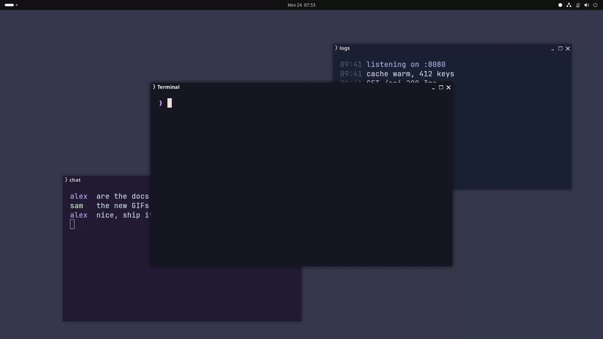

# Using wctl



## What a script can do

- **List windows** - Enumerate all windows with their metadata (ID, title, WM class, workspace, monitor, etc.), with optional workspace, monitor, and class filters
- **Window info** - Get detailed information about any window
- **Window selectors** - Address a window by ID, `focused`, WM class, title, title substring, or PID in every `wctl` command (`activate` takes all but `focused`)
- **Activate windows** - Focus/raise windows by ID, title, WM class, or PID
- **Move/resize windows** - Position and size windows programmatically
- **Window state control** - Minimize, maximize, fullscreen, always-on-top, sticky
- **Workspaces and monitors** - List them, switch workspace, move a window to a workspace or monitor
- **Wait for a window** - Block until a matching window is shown, without polling

## Examples

```bash
wctl list                          # every window; --json for the full document
                                   # (has_been_shown: false until mutter has mapped it)
wctl focused                       # the focused window
wctl info 12345 --json             # one window's details
```

The next commands use a selector instead of an ID; see
[Selectors](concepts.md#selectors).

```bash
wctl tile -c kitty left
wctl close -s "Untitled"
```

`place` takes workarea-relative tokens; see [The workarea](concepts.md#the-workarea).

```bash
wctl place 12345 center top 50% 100%

# Wait for a window to be shown, then place it
kitty &
wctl tile "$(wctl wait -p $! --timeout 5)" right

# Hide and show a window with no minimize animation, e.g. a popup
wctl minimize -c my-popup --no-animation
wctl unminimize -c my-popup --no-animation

# Show and focus a minimized window in one call, with no animation
wctl activate 12345 --no-animation

wctl --help                        # every command, global options, and --json/--settled
```

## Exit codes

A failing `wctl` classifies itself, so a script can tell the cases apart without
matching the message text:

| Code | Meaning |
|------|---------|
| 0 | Success |
| 1 | Usage error, or a failure with no more specific code below |
| 2 | The window, workspace or monitor does not exist |
| 3 | The shell refused: the frame is pinned by maximize, fullscreen or tiling, the window is held on all workspaces, it cannot be minimized, or it is hidden and cannot take the focus |
| 4 | Timed out waiting for a window, or for the shell to reply |
| 5 | The extension is not usable: not running, or a version this `wctl` cannot rely on |

Code 1 stays the catch-all it always was, so a script that only tests for a
non-zero status is unaffected.

## Sizing a window before it exists

`resolve-place` answers what a placement would be, without a window and without
moving anything — so a program can be launched at its final size instead of being
moved after it appears:

```bash
read -r w h < <(wctl resolve-place center top 50% 100% --json |
                jq -r '.target | "\(.width) \(.height)"')
```

`place`, `tile` and `center` take `--json` too, reporting the workarea used and
the rectangle computed. Once the window is known, every outcome is a document:
a window or monitor that is gone gives `"placed":false` and a `message`. All of
them report the rectangle wctl **requested**;
mutter still clamps to size hints, and a client that quantises its own size (a
terminal, to whole cells) settles a few pixels off, so comparing against it needs
a tolerance.

A window with a minimum size above the rectangle, such as a text editor in a
narrow tile, grows to that minimum at the position asked for. `move-resize`,
`place` and `tile` keep the frame on the screen, unless the window was already
partly off it; `move` can put a window partly off it.

## Waiting for the frame to settle

A geometry request is applied asynchronously, and a client may resize itself once
more after being placed, so the frame can still be moving when `wctl` exits.
`--settled` returns only once it has stopped. The window is placed either way: a
frame that never settles exits 4 and still reports `"placed":true`.

## Checking the extension version

```bash
wctl version               # just this binary, no D-Bus call
wctl version --json
# {"wctl":"0.25.0","expects_extension":"25","min_extension":"16","extension":"25","compatible":true,"capabilities":["rules","rules-title-affix","rules-class-prefix","rules-overlay","rules-min-width","rules-apply","rules-dropin","keybindings","no-animation","activate-no-animation"]}
```

`--json` asks the **running shell** what it has loaded. That is the useful
question: on Wayland an install lands on disk while the shell keeps serving the
old code until you log out, so `metadata.json` can say 10 while the answer here
is still 9. `compatible` is true for every extension version from
`min_extension` to `expects_extension`; outside that range the command exits 5.

For what `capabilities` lists, see [Capabilities](concepts.md#capabilities).
When the call fails for another reason (a timeout, an extension disabled
in between), `capabilities` is `null` and the command exits with that
failure's code.
